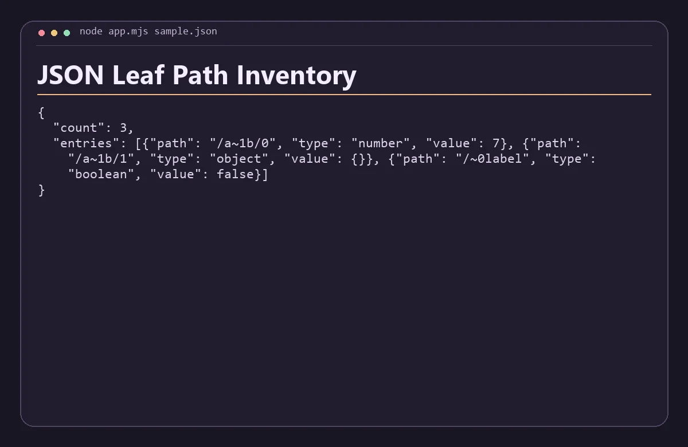

# JSON Leaf Path Inventory

Enumerate values and empty containers in nested JSON with escaped JSON Pointer paths.



## Run

Install Node.js 22 or newer. Run these commands from the repository root.

```sh
node app.mjs sample.json
```

Replace `sample.json` with a JSON file following the same structure. The app prints a JSON report to standard output.

Put the value to inspect inside the tree property. JSON Pointer encodes a slash as ~1 and a tilde as ~0. The pointer for the root is an empty string.

## Verify

Run `python check.py` with Python 3.11 or newer after the build step when applicable. The check verifies the bundled scenario and confirms that an invalid input returns an error.
